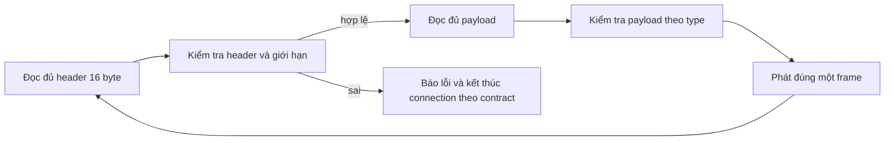

# Bài 03 · Từ dòng byte đến một thông điệp đúng

**Học trước:** Bài 02 và số nguyên/slice trong nền C#. **Câu hỏi:** nếu receive có thể trả ít hoặc nhiều hơn một thông điệp, làm sao biết byte nào thuộc header, byte nào thuộc payload?

Slide: `04-3 Socket.pdf` trang PDF 8–9, 20–21; `02 Link Layer.pdf` trang 9–14 cho ý tưởng framing. Header ứng dụng bên dưới là **thiết kế riêng** từ [Giao thức v1](../thiet-ke/Giao-thuc-v1.md), không phải TCP header hoặc bit stuffing của lớp 2.

## 1. Framing trả lời câu hỏi về ranh giới

Có nhiều cách tạo ranh giới: độ dài cố định, ký tự phân cách, length prefix. Dấu xuống dòng phù hợp một số giao thức text, nhưng dữ liệu nhị phân có thể chứa mọi giá trị byte. V1 dùng header cố định 16 byte, bên trong ghi độ dài payload.

```text
Stream: [header 16][payload L][header 16][payload M]...
Receive boundary có thể nằm ở bất cứ vị trí nào trong dãy ấy.
```

Parser là logic giữ trạng thái “đang chờ gì, đã có bao nhiêu”. Nó không lấy ranh giới Receive làm ranh giới frame. Cùng một dãy byte phải cho cùng thông điệp dù được chia thành nhiều chunk khác nhau.

## 2. Big-endian: quy ước byte, không phải phép đảo chuỗi tùy ý

Một số 32-bit `0x01020304` có bốn byte. Big-endian đặt byte trọng số lớn trước: `01 02 03 04`; little-endian đặt `04 03 02 01`. Hai bên phải dùng cùng quy ước, không phụ thuộc CPU hiện tại.

Không gửi raw layout của struct C#: còn padding, endian và field managed. [BinaryPrimitives](https://learn.microsoft.com/en-us/dotnet/api/system.buffers.binary.binaryprimitives?view=net-10.0) hỗ trợ đọc/ghi số theo endian xác định. Việc serialize object sang JSON lại là một biểu diễn khác; phải biết từng type dùng biểu diễn nào.

Ví dụ đọc vector, có thể chạy như một chương trình console nhỏ độc lập:

```csharp
using System.Buffers.Binary;
byte[] header = Convert.FromHexString("4534323301050000000000070000000c");
uint requestId = BinaryPrimitives.ReadUInt32BigEndian(header.AsSpan(8, 4));
uint payloadLength = BinaryPrimitives.ReadUInt32BigEndian(header.AsSpan(12, 4));
Console.WriteLine($"id={requestId}, payload={payloadLength}");
```

Output học tập dự kiến: `id=7, payload=12`. Đây mới là minh họa decode trường số, chưa validate header và chưa là codec hoàn chỉnh.

## 3. Giải một header từng trường

Vector REQUEST_BLOCK trong [tests/protocol-vectors.json](../../tests/protocol-vectors.json):

| Offset | Số byte | Hex | Nghĩa |
|---:|---:|---|---|
| 0 | 4 | 45 34 32 33 | Magic ASCII E423 |
| 4 | 1 | 01 | Version 1 |
| 5 | 1 | 05 | REQUEST_BLOCK |
| 6 | 2 | 00 00 | Flags v1 bằng 0 |
| 8 | 4 | 00 00 00 07 | Request ID 7 |
| 12 | 4 | 00 00 00 0c | Payload dài 12 byte |

Payload gồm ba uint32: pieceIndex=2, offset=0, length=16384. Nó dài **12 byte**, không dài 16384; request đang yêu cầu dữ liệu, chưa chứa dữ liệu ấy. Khi có BLOCK phản hồi, payload mới gồm metadata 12 byte và dữ liệu được trả.

HAVE piece 2 có type 4, ID=0, payloadLength=4; cả frame dài 20 byte. REQUEST_BLOCK ở trên có cả frame dài 28 byte. Request ID liên hệ request/response, không phải sequence number của TCP.

## 4. Máy trạng thái parser



Giữ ba câu hỏi ở mỗi bước: cần bao nhiêu byte; đã có bao nhiêu; byte thừa phải để đâu? Có thể dùng helper ReceiveExactly để lần lượt điền header/payload, hoặc parser buffer có pending data. Hai cách đều phải xử lý EOF và không mất byte.

Ví dụ ghép HAVE 20 byte + REQUEST_BLOCK 28 byte, tổng 48. Feed theo chunk `[1,3,12,2,30]`:

| Sau chunk | Tình trạng |
|---|---|
| 1 | Có 1/16 byte header |
| 3 | Có 4/16 |
| 12 | Đủ header HAVE, biết payload 4 |
| 2 | Có 2/4 payload HAVE |
| 30 | 2 byte hoàn tất HAVE, rồi 16+12 byte của REQUEST_BLOCK |

Chunk cuối phải tạo **hai** completion frame theo thứ tự. Không bỏ 28 byte sau frame đầu, cũng không coi chunk 30 byte là một frame sai.

## 5. Validate trước khi tin input

Kiểm tra theo lớp:

1. Magic/version/flags/type và type có hợp vai trò tracker/peer không?
2. Length có trong cap chung và cap riêng type không? Có biểu diễn được trong kiểu API cấp phát không?
3. Khi có payload, kiểm tra cấu trúc, ID, số trường, encoding và độ dài thực.
4. Với block, kiểm tra manifest, piece/offset/length và request đang chờ ở lớp phù hợp.

Trường length chưa đáng tin. `0xffffffff` phải bị từ chối trước allocation. REQUEST_BLOCK phải có đúng 12 byte; HAVE đúng 4; BLOCK cần cả kiểm tra metadata và số data byte. Không cộng uint rồi overflow trước khi so cap.

Một string C# không có độ dài byte bằng số ký tự trong mọi trường hợp. Ví dụ `Tệp` có 3 UTF-16 code unit nhưng UTF-8 dài 5 byte. PayloadLength phải đếm **byte UTF-8 đã encode**. Đừng decode từng Receive như một string riêng vì một ký tự có thể bị chia giữa hai lần nhận.

JSON hợp lệ chưa có nghĩa request hợp lệ: peer có thể gửi port ngoài khoảng, fileId sai định dạng hoặc string quá dài. Parser và semantic validation có trách nhiệm riêng nhưng cần failure path rõ.

## 6. EOF cần đặt trong ngữ cảnh

| EOF xảy ra | Ở tầng framing | Ở tầng phiên truyền |
|---|---|---|
| Trước byte đầu frame mới | Có thể là stream kết thúc đúng ranh giới | Vẫn có thể thất bại nếu còn request/tệp chưa xong |
| Sau 5/16 byte header | Header bị cắt | Không nhận được thông điệp hoàn chỉnh |
| Đủ header nhưng thiếu payload | Frame bị cắt | Không cộng block completion |
| Sau trọn frame | Frame trước hợp lệ | Chỉ app state quyết định toàn phiên thành công |

Cùng receive=0 có ý nghĩa khác theo tiến độ parser. Thất bại sau khi đã thuê payload cần dọn lease; dữ liệu chưa đầy không được phát như một frame thành công.

## 7. Bài tập theo mức

**A · Bằng giấy.** Tự tách vector HAVE và REQUEST_BLOCK thành bảng offset, giá trị và chiều dài frame. Đổi request ID từ 7 sang 258 rồi viết bốn byte theo big-endian.

**B · Hàm số nguyên.** Viết encode/decode header, test byte kỳ vọng đã tính độc lập. Chỉ encode rồi decode cùng code chưa đủ: hai hàm có thể cùng sai endian.

**C · Parser.** Feed cùng hai frame theo mọi vị trí cắt, theo một chunk duy nhất và từng byte. Thêm EOF ở header/payload. Không cần hai máy để kiểm tra state machine này.

**D · Input thù địch.** Sai magic/version/flags, type sai role, length cực lớn, HAVE length sai. Kiểm tra bị từ chối trước allocation lớn và không rò tài nguyên. Sau đó mới ghép parser với socket lab.

<details>
<summary>Gợi ý và kết quả để đối chiếu</summary>

258 = 0x00000102 → `00 00 01 02`. HAVE dài 16+4=20; REQUEST_BLOCK dài 16+12=28. Test endian cần một giá trị không đối xứng byte như 258 hoặc vector ID 7 cùng payload, không chỉ số 0. Với split ở mọi byte, expected frames phải không đổi. Từ chối length quá lớn là hành vi đúng, không phải “chưa hỗ trợ tệp lớn”: frame size khác file size.

</details>

Hiểu bài khi tự giải một vector và trace parser mà không dựa vào ranh giới Receive. Đầu ra implementation khi được giao là T01–T03 có test thật; đọc tài liệu/vector chưa phải pass. Tiếp [Bài 04](04-truyen-tep-va-integrity.md).
