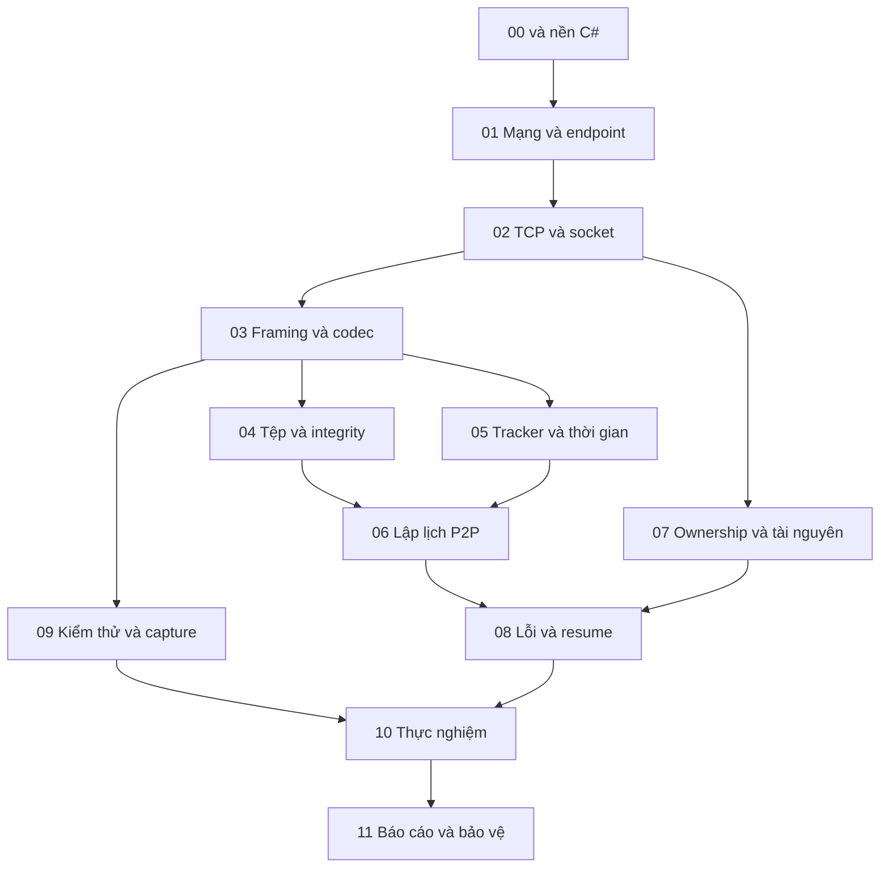

# Học từ nền tảng đến hiểu và tự xây P2P

Thư mục này là học liệu của Đề 14 ET4230 bằng C#. Mục đích là giúp người chưa biết socket hiểu cơ chế, tự giải bài nhỏ rồi mới viết một phần hệ thống. Mã ứng dụng hiện chưa có implementation P2P; ví dụ và kết quả tính trong bài là **minh họa**, không phải log chạy hoặc benchmark của nhóm.

**Linh tự phân công hàng tuần:** ai học phần nào, đọc đến mục nào và làm đến đâu. Lộ trình chuyên môn không gắn cố định với Linh/Minh/Cường/Quân/Tú. Thời gian BTL là 8 tuần, tuần 1 được xác nhận ngày 23/10/2026; số bài không phải số tuần và không buộc đọc hết trước khi thực hành.

## 1. Chưa có nền tảng thì bắt đầu thế nào?

| Nếu đang vướng | Bắt đầu tại | Sau đó |
|---|---|---|
| Chưa phân biệt source, project, thư viện, chương trình | [Bài 00](00-mo-du-an-va-CSharp.md) | Chạy bootstrap và giải thích đường phụ thuộc |
| Chưa hiểu hàm, class/struct, reference, exception, Task | [Nền tảng C#](CSharp-nen-tang.md) | Dự đoán output của ví dụ, rồi trở lại bài đang học |
| Chưa hiểu mạng, IP, port, client/server, P2P | [Bài 01](01-mang-topology-va-endpoint.md) | Tự vẽ kết nối và đường đi dữ liệu |
| Biết C# cơ bản nhưng chưa viết mạng | [Bài 02](02-socket-TCP-va-async.md) | Hiểu byte stream, socket lifecycle, gửi/nhận và EOF |
| Biết send/receive nhưng chưa biết tách thông điệp | [Bài 03](03-framing-va-giao-thuc.md) | Giải từng byte header, split/ghép và input sai |
| Có nền chung, chuẩn bị nhận một mảng riêng | [Lộ trình theo chuyên môn](Lo-trinh-theo-chuyen-mon.md) | Chọn đường đọc và bài tập theo việc Linh giao |

Đọc mà gặp từ chưa hiểu thì dừng ở ví dụ tương ứng. Không cần đoán Task, bitmap, lease hay TTL từ tên; bài học giải nghĩa trước khi yêu cầu sử dụng.

## 2. Phần chung và phần học sâu

Nền chung cho cả 5 người: source/process ở Bài 00; kiểu dữ liệu, reference, collection và async cơ bản trong tài liệu C#; mô hình mạng Bài 01; byte stream/EOF ở Bài 02; ý nghĩa header và giới hạn input ở Bài 03. Mỗi người cần hiểu thêm vì sao piece phải kiểm tra hash ở Bài 04 và vì sao peer vừa nhận vừa gửi ở Bài 06.

Mức đào sâu tùy công việc. Người làm storage không phải viết lại receive loop, nhưng cần biết buffer nào được giữ và khi nào báo ghi xong. Người làm transport cần hiểu metric đếm byte ở đâu. Nền chung giúp các phần ghép nhau theo cùng hợp đồng.

Mũi tên chỉ kiến thức hỗ trợ. Dùng Bài 09 từ lúc viết codec, không chờ đến cuối mới test. Ownership cơ bản cần hiểu trước I/O bất đồng bộ; unsafe/Vst ở Bài 07 là phần sâu hơn.

## 3. Học một bài theo bốn lượt

1. **Hiểu:** đọc vấn đề và mô hình; giải thích thuật ngữ, input/output, trách nhiệm và điều luôn phải đúng.
2. **Theo ví dụ:** tự tính/vẽ/dự đoán trước, rồi đối chiếu lời giải. Số trong bài là dữ liệu học tập được gắn nhãn.
3. **Tự làm:** giải bài giấy hoặc hàm nhỏ, thử một ca bình thường và một ca sai. Đọc gợi ý sau khi đã thử.
4. **Áp dụng:** khi Linh giao, nối phần đã hiểu vào contract dự án và viết test tương ứng.

Nếu chưa giải thích được ví dụ thì quay lại lượt 1–2. Đọc xong trang hoặc copy được code chưa chứng minh hiểu. Không cần hồ sơ học cá nhân; gửi câu trả lời, sơ đồ hoặc diff trong cuộc trao đổi/task đang dùng là đủ để review.

## 4. Mục lục bài giảng

| Bài | Câu hỏi dẫn đường | Kiến thức chính |
|---|---|---|
| [00](00-mo-du-an-va-CSharp.md) | Code trở thành chương trình chạy ra sao? | Solution/project/assembly/process, build/run, dependency |
| [C# nền tảng](CSharp-nen-tang.md) | Dữ liệu được truyền, sao chép và sống đến khi nào? | Hàm, value/reference, collection, lỗi, async, Memory |
| [01](01-mang-topology-va-endpoint.md) | Byte đến đúng ứng dụng trên máy khác thế nào? | Phân lớp, endpoint, LAN, NAT, CS/P2P, trễ/goodput |
| [02](02-socket-TCP-va-async.md) | TCP bảo đảm gì và ứng dụng còn phải làm gì? | Listener/connected socket, byte stream, EOF, task/cancel |
| [03](03-framing-va-giao-thuc.md) | Tách thông điệp từ dòng byte thế nào? | Header, endian, length, parser state, validation |
| [04](04-truyen-tep-va-integrity.md) | Nhận đủ byte đã là nhận đúng tệp chưa? | Piece/block, offset, SHA-256, manifest, writer/Verified |
| [05](05-tracker-va-discovery.md) | Thông tin peer còn đúng trong bao lâu? | Registry key, heartbeat/TTL, monotonic time, stale data |
| [06](06-P2P-scheduler-va-pipeline.md) | Nhiều nguồn phối hợp ra sao? | Bitmap, sequential/rarest-first, pipeline, credit, state |
| [07](07-ownership-buffer-va-Vst.md) | Ai được dùng và ai phải trả buffer? | Owner/consumer, queue, budget, unmanaged, Vst audit |
| [08](08-peer-roi-va-resume.md) | Lỗi chen giữa hai bước thì sao? | Deadline/retry, generation, late result, crash/resume |
| [09](09-kiem-thu-va-capture.md) | Chứng minh hoạt động bằng cách nào? | Unit/integration, oracle, fake clock/stream, log/pcap |
| [10](10-thuc-nghiem-va-phan-tich.md) | Số đo cho phép kết luận điều gì? | Biến, đối chứng, denominator, thống kê, bottleneck |
| [11](11-bao-cao-demo-va-bao-ve.md) | Giải thích kết quả và phần mình làm thế nào? | Luận điểm–bằng chứng, báo cáo, demo, bảo vệ |

Tra slide bằng [bản đồ kiến thức](Kien-thuc-tu-slide.md). Tên file và trang trong bài là **trang PDF 1-based**. Đọc cùng [ghi chú chuẩn hóa](Ghi-chu-chuan-hoa-slide.md), nhất là window/RTT và TCP. Nguồn RFC/Microsoft/BEP/Wireshark được dẫn ở bài cần dùng; không yêu cầu người mới đọc toàn bộ tiêu chuẩn trước.

## 5. Kiến thức riêng cá nhân được chọn thế nào?

[Lộ trình theo chuyên môn](Lo-trinh-theo-chuyen-mon.md) có năm hướng: transport/giao thức; tệp/hash/I/O; tracker/thời gian; scheduler/đồng thời; kiểm thử/thực nghiệm. Mỗi hướng nêu phần cần biết trước, mục đọc cụ thể, ví dụ cần tự giải và phần sâu để mở rộng. Ai học hướng nào do Linh giao; có thể đổi hoặc học chéo.

Ví dụ giao học, **không gán cho thành viên cụ thể**: “Tuần này học tracker: Bài 01 phần endpoint, Bài 05 phần TTL/registry; tự giải timeline heartbeat, rồi viết registry trong bộ nhớ với đồng hồ giả.” Nếu người nhận chưa hiểu Dictionary/record thì thêm các mục đó trong nền C# trước khi yêu cầu code.

Một giao việc đủ rõ gồm: người nhận do Linh chọn → kiến thức cần hiểu → mục đọc → bài tập nhỏ → đầu ra để review. Backlog và lịch 8 tuần ở [Kế hoạch](../Ke-hoach.md) là nguyên liệu để Linh sắp xếp; học liệu không tự đặt deadline hoặc ghi nhận ai đã học xong.

## 6. Nguồn quyết định khi có khác nhau

Lý thuyết môn học nằm trong slide và nguồn chuẩn; thiết kế v1 nằm ở [kiến trúc](../thiet-ke/Kien-truc-du-an.md), [giao thức](../thiet-ke/Giao-thuc-v1.md), [audit Vst](../thiet-ke/Tai-su-dung-VstHelper.md). Bài học giải thích quyết định và ví dụ, không định nghĩa một giao thức cạnh tranh. Thay đổi thiết kế phải cập nhật contract/vector trước khi hai người viết theo hai cách khác nhau.

Ví dụ C# ngắn chỉ dạy một cơ chế, không là implementation P2P hoàn chỉnh. Bài tập chỉ có kết quả thật khi người học chạy/giải và đưa evidence; tài liệu không tick hoàn thành thay thành viên.
