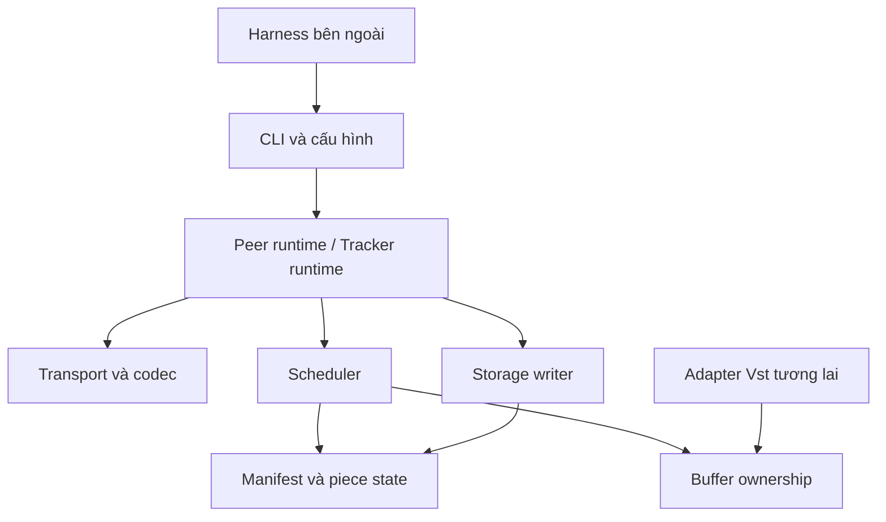

# Kiến trúc C# cho Đề 14

Thiết kế nội bộ v1 ngày 23/10/2026. Chưa phải các tính năng đã hiện thực. Dùng ít project: `ET4230.Core`, `ET4230.Cli`, và `ET4230.VstReference` để biên dịch reference độc lập. Khi tích hợp Vst có thể tạo một adapter riêng, không cho Core phụ thuộc thẳng vào mọi API unsafe.

## Ranh giới và hướng phụ thuộc

CLI điều phối và nhận tham số; Core chứa nghiệp vụ và socket; harness chạy chương trình và thu kết quả. Core không gọi ngược script thử nghiệm. Một module ban đầu có thể chỉ là vài file trong Core, không cần mỗi module là một assembly hoặc một lớp manager chung.

## Trách nhiệm và hợp đồng

| Module | Input/output dự kiến | Sở hữu gì |
|---|---|---|
| Manifest | Tệp local → kích thước, hash, piece metadata | Dữ liệu immutable sau kiểm tra |
| Codec/Transport | Byte stream ↔ frame hợp lệ; event kết nối | Socket, receive loop, send queue mỗi connection |
| Discovery | Endpoint đăng ký/tra cứu → danh sách peer có TTL | Registry ở tracker; cache địa chỉ ở peer |
| Scheduler | Availability và completion → yêu cầu block | State machine, request IDs/generation, deadline, chính sách chọn |
| Storage | `(offset, buffer, length)` → completion ghi/hash | Handle tệp `.part`, hàng đợi ghi có giới hạn |
| Buffers | Thuê → lease; dispose lease → trả | Vùng nhớ, budget và thống kê live/high-water |
| Diagnostics | Sự kiện → JSONL/log/counters | Bộ ghi log; không thay quyền sở hữu dữ liệu |

Core cơ sở dùng `Socket`, `Memory<byte>`, BCL và một buffer tái sử dụng cho đường truyền. Chọn `Channel<T>` có capacity để nối receive với writer khi đến chặng đồng thời. API cụ thể phải được nhóm review trước khi tạo implementation.

## Một vòng nhận dữ liệu

1. Scheduler dành request ID và một đơn vị credit/budget; ghi expected piece/offset/length.
2. Một send queue trên kết nối phát đủ header và payload. Các task không ghi xen frame vào cùng socket.
3. Một receive loop trên kết nối đọc đủ 16 byte header; kiểm tra trước khi cấp bộ nhớ payload.
4. BLOCK phải khớp request đang chờ, offset và độ dài thực tế trong piece. Dữ liệu thừa/trễ được xử lý theo generation; không tự cộng completion hai lần.
5. Transfer quyền sở hữu buffer cho WriteJob. Receive không còn được dùng/trả lease đó.
6. Writer ghi đủ dữ liệu vào offset, xác nhận completion rồi trả lease theo hợp đồng. Một piece chỉ đủ dữ liệu sau các completion ghi, không chỉ sau receive.
7. Khi piece đủ, đọc lại vùng `.part` để SHA-256. Hash đúng → Verified → gửi HAVE; hash sai → reset dữ liệu/state cần tải lại với retry budget hữu hạn.

Buffer đường receive, buffer gửi, hàng đợi writer và scratch hash phải cùng được tính trong memory budget. Không chỉ giới hạn một queue rồi gọi toàn hệ thống là bounded.

## State machine và invariant

- Block: Missing → InFlight → Received → Written. Timeout/ngắt trước completion có thể đưa về Missing; generation tăng khi giao lại.
- Piece: Missing/Partial → Verifying → Verified. Chỉ Verified được upload và công bố.
- Request: Pending → Succeeded/Failed/Cancelled/Expired; trạng thái cuối chỉ được ghi một lần.
- Một block có nhiều kết quả đến muộn vẫn chỉ làm tăng số block hoàn tất một lần. Một buffer có đúng một owner chịu trách nhiệm trả.
- Các piece ID thuộc `[0, pieceCount)`; offset cộng length không vượt kích thước piece/tệp; dùng kiểm tra overflow trước khi chuyển sang int.
- Kết nối mới trao đổi bitmap hiện tại; HAVE từ peer khác chỉ là thông tin availability mà họ công bố, không thay việc tự kiểm tra dữ liệu nhận.

Khi một peer rời: tracker có thể còn cache tới TTL; transport lỗi/timeout cung cấp tín hiệu sớm cho scheduler. Đủ nguồn còn giữ dữ liệu mới có khả năng hoàn tất; thiếu nguồn phải báo trạng thái, không retry vô hạn.

## Đồng thời và I/O

Bản đầu ưu tiên một scheduler sở hữu state, một writer cho mỗi tệp, và mỗi connection có một reader + một writer queue. Không giữ khóa hoặc con trỏ vào collection có thể realloc trong lúc await. Không dùng `LockEngine` như async lock; cơ chế native blocking phải được đánh giá riêng.

BCL storage có thể dùng API ghi với offset; khi so với `Win32File.Seek → Write`, điều phối cả cặp thao tác ở một writer. Chính sách flush/write-through phải được ghi và giữ tương đương giữa các cấu hình. Resume khởi động lại cần rehash các piece được cho là Verified trước khi thông báo HAVE; metadata có thể tồn tại trong khi dữ liệu chưa bền sau crash.

## Baseline và thay chính sách

- Mode client–server: chỉ nguồn ban đầu phục vụ dữ liệu, receiver không upload.
- Mode P2P: cùng codec/storage/hash, receiver upload Verified piece.
- Chính sách sequential và rarest-first dùng cùng giới hạn connection/inflight/buffer.
- Buffer per-connection, ArrayPool và Vst adapter dùng cùng network/scheduler/storage khi benchmark.

Không thay đồng thời allocator, lịch chọn piece và chính sách ghi rồi quy kết cải thiện cho một yếu tố.

## Cây mã đích

Khi đến task mới tạo các file có trách nhiệm thật: `Protocol/FrameHeader.cs`, `Protocol/FrameCodec.cs`, `Transport/PeerConnection.cs`, `Manifest/FileManifest.cs`, `Discovery/TrackerRegistry.cs`, `Scheduling/PieceScheduler.cs`, `Storage/PieceWriter.cs`, `Buffers/BufferLease.cs`. Tên là gợi ý để review, chưa phải API đã tồn tại. Test sẽ nằm trong test project riêng khi có chức năng để kiểm chứng.

Đọc tiếp [giao thức](Giao-thuc-v1.md), [kiểm thử](../kiem-chung/Ke-hoach-kiem-thu.md) và [VstHelper](Tai-su-dung-VstHelper.md).
